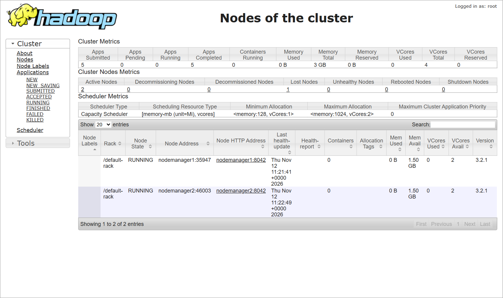
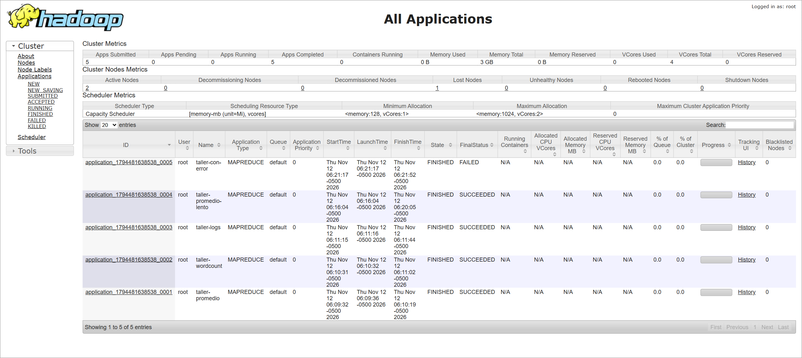
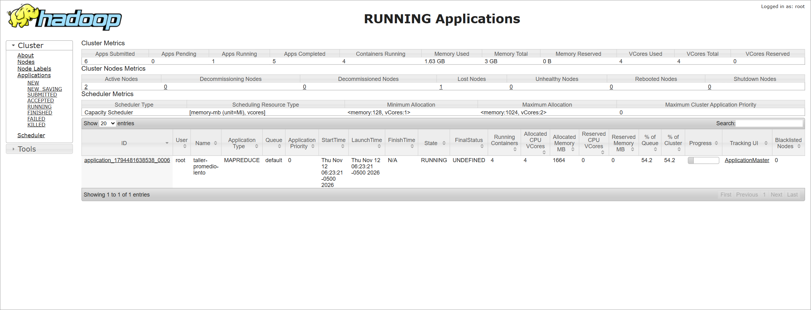
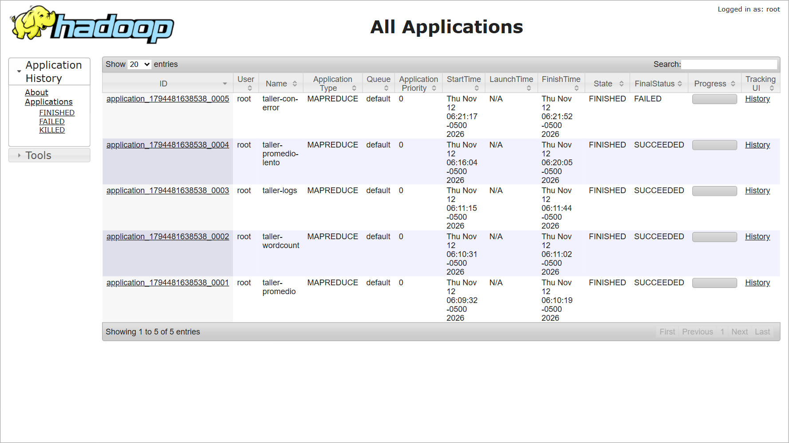
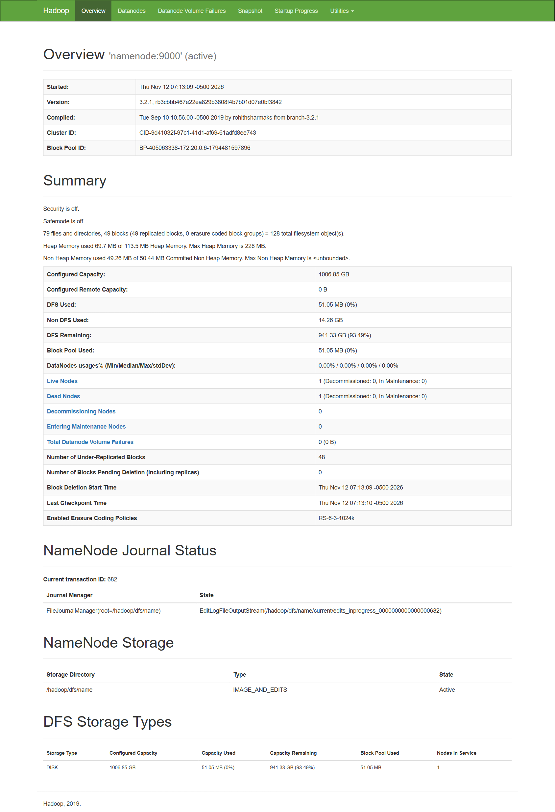
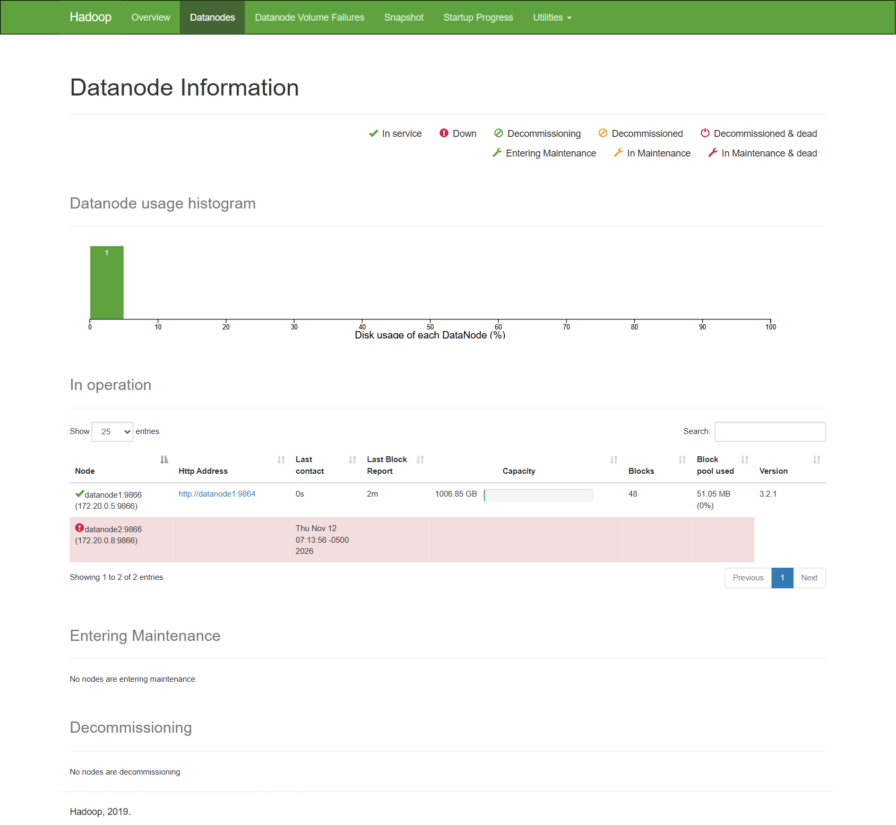

# Taller HDFS + Hadoop MapReduce con Docker

Clúster Hadoop 3.2.1 (HDFS + YARN) en Docker Compose, con 3 trabajos MapReduce en Python
(Hadoop Streaming), validación de resultados y pruebas de tolerancia a fallos.

> Guía completa paso a paso (conceptos, comandos y resultados esperados):
> [`docs/guia_taller_hdfs.html`](docs/guia_taller_hdfs.html) — descargar y abrir en el navegador.

## Arquitectura

| Contenedor | Rol | Web |
|---|---|---|
| `namenode` | HDFS: guarda el "índice" (qué bloques forman cada archivo y en qué nodo están) | http://localhost:9870 |
| `datanode1`, `datanode2` | HDFS: guardan los bloques. Replicación = 2 (cada bloque vive en ambos) | — |
| `resourcemanager` | YARN: reparte memoria/CPU y decide dónde corre cada tarea | http://localhost:8088 |
| `nodemanager1`, `nodemanager2` | YARN: ejecutan las tareas map/reduce (traen Python 3) | — |
| `historyserver` | YARN Timeline: historial de aplicaciones terminadas | http://localhost:8188 |
| `client` | Desde aquí se dan los comandos `hdfs`, `yarn`, `hadoop jar` | — |

Ajustes clave en `hadoop.env`: `mapreduce.framework.name=yarn` (sin esto los jobs corren en modo
local y no aparecen en YARN), `dfs.replication=2`, bloques de 4 MB, un DataNode se marca *Dead* en
~60 s y un NodeManager *LOST* en 30 s (para poder demostrar los fallos en clase), y agregación de logs.

## Datasets y jobs

`scripts/generar_datos.py` genera (semilla fija) 3 datasets y calcula sus resultados esperados sin Hadoop:

| Job | Dataset (HDFS) | Mapper → Reducer | Salida |
|---|---|---|---|
| 1. Promedio por clave | `/taller/input/ventas/ventas.csv` (260 000 ventas, ~8,5 MB) | `categoria, valor` → promedio, cantidad y total | `/taller/output/promedio` |
| 2. WordCount (+ combiner) | `/taller/input/resenas/resenas.txt` (150 000 reseñas, ~11 MB) | `palabra, 1` → suma | `/taller/output/wordcount` |
| 3. Análisis de logs | `/taller/input/logs/logs_servidor.log` (280 000 líneas, ~14 MB) | `hora, 1, es_error` → peticiones, errores, % | `/taller/output/logs` |

## Ejecución (Windows PowerShell, macOS o Linux)

```bash
docker compose up -d --build                          # 1. levantar el clúster (la 1.ª vez tarda)
docker compose ps                                     #    todos deben estar "Up"
docker compose exec client bash scripts/01_cargar_datos.sh   # 2. generar datos y subirlos a HDFS
docker compose exec client bash scripts/02_ejecutar_jobs.sh  # 3. correr los 3 jobs en YARN
docker compose exec client bash scripts/03_validar.sh        # 4. comparar con el resultado esperado
docker compose exec client bash scripts/estado.sh            # estado de nodos y aplicaciones
```

Comandos útiles dentro del cliente (`docker compose exec client bash`):

```bash
hdfs dfs -ls -R /taller
hdfs dfs -cat /taller/output/promedio/part-00000
hdfs fsck /taller/input -files -blocks -locations
yarn application -list -appStates ALL
yarn logs -applicationId <application_id> | less
```

## Pruebas de tolerancia a fallos

| # | Prueba | Cómo | Qué se observa |
|---|---|---|---|
| 1 | Apagar un DataNode | `docker compose stop datanode2`, esperar ~60 s, `scripts/estado.sh`, leer un archivo; luego `docker compose start datanode2` | 1 Dead node, bloques *under-replicated*, pero los archivos se siguen leyendo; al volver: Healthy |
| 2 | Reiniciar un contenedor durante una operación HDFS | Mientras corre un `hdfs dfs -put` de un archivo grande: `docker compose restart datanode1` | El `put` termina igual (recuperación del pipeline de escritura) y el archivo queda completo |
| 3 | Detener un NodeManager con un job corriendo | `scripts/04_job_lento.sh` y, mientras corre, `docker compose stop nodemanager2` | El NodeManager pasa a LOST, YARN reprograma sus tareas en `nodemanager1` y el job termina SUCCEEDED |
| 4 | Fallo dentro de un Map | `scripts/05_job_con_error.sh` | Cada tarea map se reintenta 4 veces y el job queda FAILED; se lee el error con `yarn logs` |

El detalle de cada prueba, con las salidas obtenidas, está en la guía HTML.

## Resultados obtenidos (12-nov-2026)

Toda la evidencia en texto está en [`resultados/`](resultados/) y las capturas en [`docs/img/`](docs/img/).

### Clúster

| Verificación | Resultado |
|---|---|
| Contenedores | 8 de 8 en `Up (healthy)` |
| HDFS | 2 DataNodes vivos, 10 bloques de entrada con 2 réplicas cada uno, `HEALTHY` ([`01_carga_hdfs.txt`](resultados/evidencia/01_carga_hdfs.txt)) |
| YARN | 2 NodeManagers `RUNNING` ([`estado_inicial.txt`](resultados/evidencia/estado_inicial.txt)) |




### Jobs MapReduce

| Aplicación YARN | Job | Estado final | Validación |
|---|---|---|---|
| `application_…_0001` | taller-promedio | SUCCEEDED | 6 de 6 claves coinciden con lo esperado |
| `application_…_0002` | taller-wordcount | SUCCEEDED | 67 de 67 claves coinciden |
| `application_…_0003` | taller-logs | SUCCEEDED | 24 de 24 claves coinciden |
| `application_…_0004` | taller-promedio-lento (prueba 3) | SUCCEEDED | mismo resultado que el job 1 |
| `application_…_0005` | taller-con-error (prueba 4) | FAILED (a propósito) | — |

**Job 1: promedio de ventas por categoría** ([`promedio.tsv`](resultados/promedio.tsv))

| Categoría | Promedio | N.º de ventas | Total |
|---|---:|---:|---:|
| alimentos | 42 480,41 | 77 749 | 3 302 809 300 |
| deportes | 320 257,54 | 23 315 | 7 466 804 600 |
| electronica | 1 403 720,81 | 31 503 | 44 221 416 800 |
| hogar | 209 572,94 | 46 569 | 9 759 602 200 |
| libros | 68 018,20 | 15 498 | 1 054 146 100 |
| ropa | 140 300,93 | 65 366 | 9 170 910 500 |

**Job 2: WordCount, top 8 palabras** ([`wordcount.tsv`](resultados/wordcount.tsv)): el 180 176 · la 119 824 · y 98 171 · lo 56 048 · fue 51 843 · llegó 51 576 · es 37 715 · muy 37 658.

**Job 3: horas pico y errores** ([`logs.tsv`](resultados/logs.tsv)). La hora pico es las 20:00 (29 290 peticiones). Las horas 12, 13, 19 y 20 tienen alrededor del 9 % de errores; el resto, alrededor del 3 %.

| Hora | Peticiones | Errores | % error |
|---|---:|---:|---:|
| 12 | 23 256 | 2 118 | 9,11 |
| 13 | 21 996 | 1 944 | 8,84 |
| 19 | 26 069 | 2 371 | 9,10 |
| 20 | 29 290 | 2 657 | 9,07 |
| 21 | 20 571 | 609 | 2,96 |





### Pruebas de tolerancia a fallos

| # | Prueba | Resultado observado | Evidencia |
|---|---|---|---|
| 1 | Apagar `datanode2` | El NameNode lo marcó **Dead** a los ~70 s. Los 10 bloques de entrada quedaron con 1 réplica (*under-replicated*) y **0 bloques perdidos**; `ventas.csv` se leyó completo (260 001 líneas). Al encenderlo de nuevo, en 25 s volvió a 2 réplicas y `HEALTHY`. | [`prueba1_datanode_apagado.txt`](resultados/evidencia/prueba1_datanode_apagado.txt) |
| 2 | `restart datanode1` durante un `hdfs dfs -put` de 14 MB | El cliente registró `Connection reset by peer` → `Excluding datanode 172.20.0.4` y siguió con el otro nodo. El `put` terminó con código 0 en 6,6 s y el MD5 es idéntico (`77b3e925…`). | [`prueba2_reinicio_durante_put.txt`](resultados/evidencia/prueba2_reinicio_durante_put.txt) |
| 3 | `stop nodemanager2` con el job lento corriendo | `nodemanager2` pasó a **LOST** ~40 s después. El ApplicationMaster mató `m_000002_0` ("running on unusable node") y lo relanzó como `m_000002_1` en `nodemanager1`. El progreso bajó de 32 % a 17 % y el job terminó **SUCCEEDED** con el resultado correcto. | [`prueba3_nodemanager_detenido.txt`](resultados/evidencia/prueba3_nodemanager_detenido.txt), [`prueba3_logs_applicationmaster.txt`](resultados/evidencia/prueba3_logs_applicationmaster.txt) |
| 4 | Mapper que lanza una excepción | Cada tarea map se intentó 4 veces (`_0` a `_3`): 11 tareas lanzadas y 10 fallidas. El job quedó **FAILED** y `yarn logs` muestra el `RuntimeError` de Python. | [`prueba4_mapper_con_error.txt`](resultados/evidencia/prueba4_mapper_con_error.txt), [`prueba4_traceback.txt`](resultados/evidencia/prueba4_traceback.txt) |




**Conclusiones**
- HDFS no perdió datos al caer un nodo gracias a la replicación.
- La escritura sobrevive a un nodo que se reinicia gracias a la recuperación del *pipeline*.
- YARN repite en otro nodo las tareas de una máquina perdida.
- Los reintentos no salvan un job cuando el error está en el código.

## Apagar

```bash
docker compose down        # apaga (conserva los datos de HDFS)
docker compose down -v     # apaga y BORRA los datos de HDFS
```

Si los puertos 9870/8088/8188 están ocupados: `PUERTO_HDFS=19870 PUERTO_YARN=18088 PUERTO_HISTORY=18188 docker compose up -d`
(en PowerShell: `$env:PUERTO_HDFS=19870; ...`).
